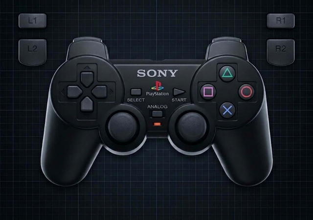
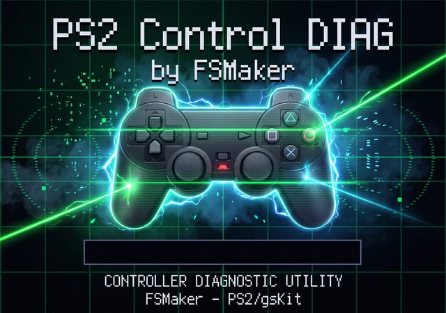

# PS2 Pad Diag

Tester diagnostico per controller PlayStation 2 (DualShock / DualShock 2),
porting PS2 del progetto PS1
[ControlDiagPSX](https://github.com/FSMaker77/ControlDiagPSX).

Diagnostic tool for PlayStation 2 controllers (DualShock / DualShock 2),
PS2 port of the PS1 project
[ControlDiagPSX](https://github.com/FSMaker77/ControlDiagPSX).

<p align="center">
  <a href="controller_ps2.png"></a>
  <a href="splash.jpg"></a>
</p>

---

## Italiano

### Cosa fa

Mostra a schermo un render del DualShock 2 e verifica in tempo reale:

- tutti i pulsanti: croce direzionale, △ ○ ✕ □, L1/L2/R1/R2, SELECT/START, L3/R3;
- la **pressione analogica** dei tasti sensibili (l'intensità del verde segue la
  pressione 0–255);
- i due **stick analogici**, con un puntino che si muove nel pozzetto e le
  coordinate X/Y;
- i **motori di vibrazione**: tieni premuto **L2** per il motore grande (barra
  BIG), **R2** per il piccolo (barra SML);
- un **click audio** a ogni pressione di pulsante.

La schermata mostra il controller reale e la splash con la barra di caricamento.
La UI è pensata su una griglia 320×224 scalata 2× (640×448) con margini per
l'overscan; il testo usa un font bitmap 5×10 incorporato (Terminus, SIL OFL 1.1,
vedi `FONT-LICENSE.txt`).

Viene usato un solo pad di controllo: la porta 1 se collegata, altrimenti la
porta 2. La porta attiva è evidenziata nell'header.

### Controlli

| Input | Cosa fa |
|---|---|
| Croce direzionale | evidenzia il braccio premuto |
| △ ○ ✕ □ | evidenzia il tasto e la pressione |
| L1 / L2 / R1 / R2 | evidenzia il tasto; L2 = motore grande, R2 = piccolo |
| SELECT / START | evidenzia il tasto |
| L3 / R3 | anello verde sullo stick, coordinate X/Y |
| Stick analogici | puntino mobile nel pozzetto |

### Avvio

Serve **un solo file**: `PS2PAD-DIAG.ELF`.

1. copia `PS2PAD-DIAG.ELF` sulla chiavetta USB (ad esempio in `mass:/APPS/`);
2. avvia **uLaunchELF** (FreeMcBoot);
3. vai su `mass:/APPS/PS2PAD-DIAG.ELF` e premi ✕.

I moduli necessari sono già dentro l'ELF: non servono altri file.

Il programma si adatta alla regione della console: su una PS2 PAL esce a
576i/50 Hz, su una PS2 NTSC a 480i/60 Hz (la UI 640×448 viene centrata nella
cornice PAL con bande nere sopra e sotto).

### Build

Requisiti: [ps2sdk](https://github.com/ps2dev/ps2sdk) in `$PS2SDK`,
[gsKit + dmaKit](https://github.com/ps2dev/gsKit) e toolchain EE.

```sh
make
```

Produce `ps2pad-diag.elf`.

---

## English

### What it does

Shows a DualShock 2 render and live-tests:

- every button: d-pad, △ ○ ✕ □, L1/L2/R1/R2, SELECT/START, L3/R3;
- **analog pressure** on pressure-sensitive buttons (green intensity follows the
  0–255 value);
- both **analog sticks**, with a dot moving inside the well and X/Y readouts;
- the **vibration motors**: hold **L2** for the big motor (BIG bar), **R2** for
  the small one (SML bar);
- a short **click sound** on every button press.

The screen uses the real controller artwork and the splash with the loading bar.
The UI is designed on a 320×224 grid scaled 2× (640×448) with CRT overscan
margins; text uses an embedded 5×10 bitmap font (Terminus, SIL OFL 1.1, see
`FONT-LICENSE.txt`).

A single control pad drives the UI: port 1 if connected, otherwise port 2. The
active port is highlighted in the header.

### Controls

| Input | Action |
|---|---|
| D-pad | highlights the pressed arm |
| △ ○ ✕ □ | highlights the button and the pressure |
| L1 / L2 / R1 / R2 | highlights the button; L2 = big motor, R2 = small |
| SELECT / START | highlights the button |
| L3 / R3 | green ring on the stick, X/Y readout |
| Analog sticks | moving cursor inside the well |

### Launching

Only **one file** is needed: `PS2PAD-DIAG.ELF`.

1. copy `PS2PAD-DIAG.ELF` to the USB stick (for example `mass:/APPS/`);
2. start **uLaunchELF** (FreeMcBoot);
3. go to `mass:/APPS/PS2PAD-DIAG.ELF` and press ✕.

Every module it needs is inside the ELF: no other file is required.

The program follows the console region: a PAL PS2 outputs 576i/50 Hz, an NTSC
PS2 outputs 480i/60 Hz (the 640×448 UI is centred inside the PAL frame with
black bars above and below).

### Build

Requirements: [ps2sdk](https://github.com/ps2dev/ps2sdk) in `$PS2SDK`,
[gsKit + dmaKit](https://github.com/ps2dev/gsKit) and the EE toolchain.

```sh
make
```

Produces `ps2pad-diag.elf`.

---

## Project layout

| File | Purpose |
|---|---|
| `main.c` | UI, splash, button overlays, click edge detection |
| `gfx_ps2.c/h` | gsKit 2D layer (quads, text, shapes, backgrounds) |
| `pad_ps2.c/h` | libpad polling, pressure, actuators |
| `audio.c/h` | audsrv ADPCM click |
| `modules.c/h` | IOP module loading (embedded copies, fallbacks) |
| `sio2man_irx.c`, `padman_irx.c` | IOP modules embedded in the ELF |
| `sbv/` | LoadModuleBuffer patch from ps2sdk (AFL-2.0) |
| `font6x8.h` | generated 5×10 bitmap font |
| `click.sad` | generated one-shot ADPCM click |
| `controller_ps2.png` | controller artwork |
| `assets/controller.raw` | 640×448 CT32 controller background |
| `splash.jpg` | splash artwork |
| `assets/splash.raw` | 640×448 CT32 splash background |
| `tools/genfont.py` | font generator |
| `tools/mkbg.py` | artwork → CT32 raw converter |

## Credits / Licenses

- Project code: MIT, see `LICENSE`.
- Embedded bitmap font derived from **Terminus** by Dimitar Zhekov, SIL Open
  Font License 1.1, see `FONT-LICENSE.txt`.
- `sbv/` = LoadModuleBuffer patch from ps2sdk, Academic Free License 2.0.
- PS2SDK, gsKit, dmaKit, libpad, audsrv: their respective licenses.
